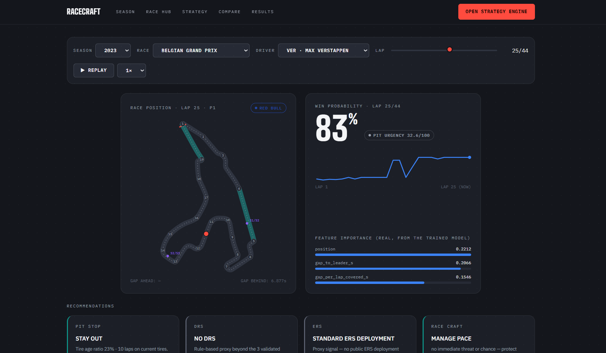
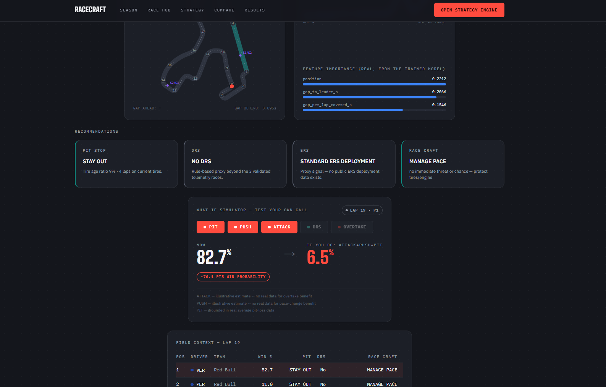
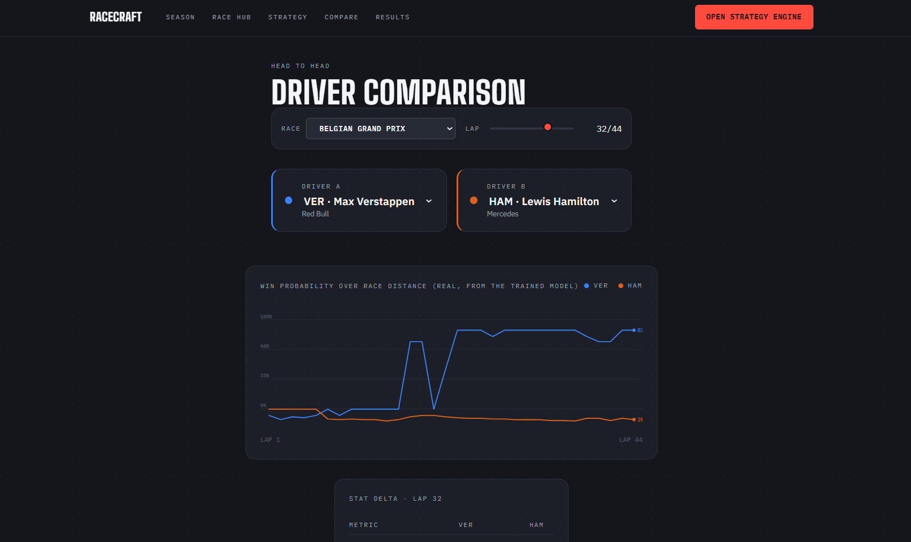
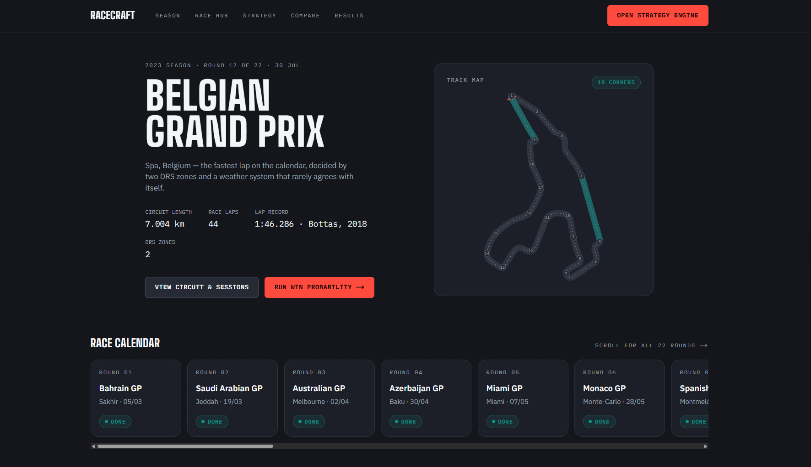
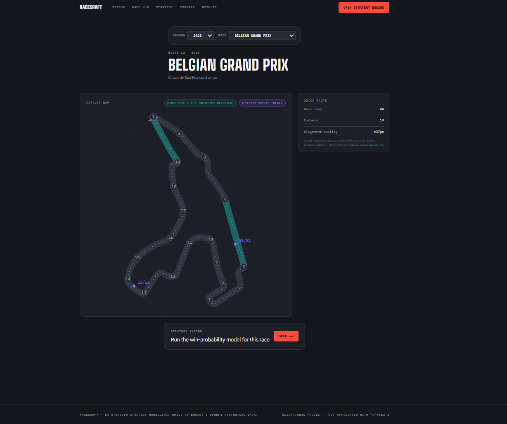
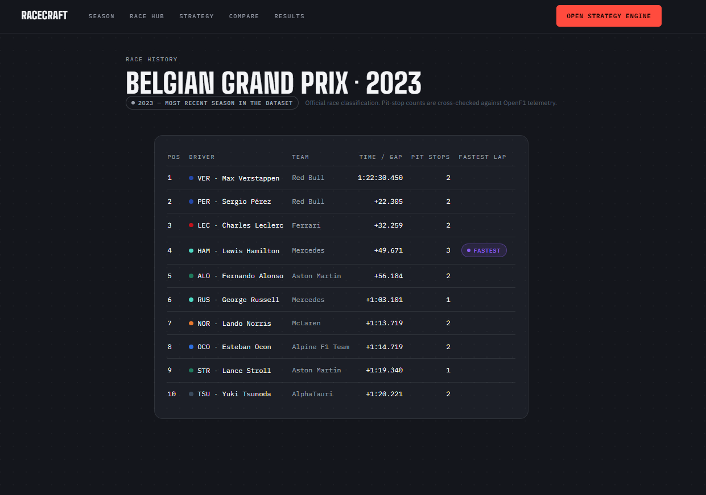

# RACECRAFT: F1 Strategy and Win Probability

RACECRAFT analyzes historical Formula 1 races lap by lap. A calibrated Random Forest estimates each driver's win probability; a separate strategy engine adds transparent pit urgency, DRS/ERS proxies, race-craft guidance, and what-if simulations. The web app replays recorded races. It is not connected to live timing and is not a pit-wall decision system.

## Features

- Lap-by-lap win-probability history and field context.
- Pit urgency scoring, DRS availability proxy, ERS proxy, and attack/defend/manage calls.
- Pit timing comparisons and what-if actions: `pit`, `push`, `attack`, `drs`, and `overtake`.
- Driver comparison, race lookup, circuit maps, and historical result pages.
- FastAPI endpoints for model metrics and per-prediction SHAP explanations. SHAP is available through the API but is not currently shown in the dashboard.

Recommendations are not all model outputs. Pit calls and race craft are rules; DRS and ERS are explicitly proxies; push and # 🏎️ F1 Strategy & Win Probability Predictor (RACECRAFT)


A machine-learning system that estimates a driver's **win probability lap by lap** and pairs it with race-engineer-style recommendations: pit timing, DRS, ERS (proxy), and attack / defend / manage pace. A what-if simulator lets you test your own hypotheses ("what if I pit now?", "what if I get DRS?").

## 🔗 Live Demo

**👉 [https://f1-strategy-recommendation-system.vercel.app](https://f1-strategy-recommendation-system.vercel.app/)**

> The backend runs on Render's free tier, so the **first request after a period of inactivity can take a minute** while the service wakes up and loads its data. Later requests are fast.

## 📸 Screenshots

**Strategy engine:** win-probability trend, live recommendations and feature importance (2023 Belgian GP, lap 25, Verstappen)



**What-if simulator and field context:** test pit / push / attack / DRS / overtake calls against the exact race state



**Driver comparison:** win probability over the race distance, side by side



| Home | Race hub | Results |
|---|---|---|
|  |  |  |

---

## 📌 What it does

Given the state of a race (lap, position, gaps, tire age, pit history), the project produces:

1. **Win probability**: the chance a given driver wins the race, re-estimated every lap by a calibrated Random Forest.
2. **Recommendations**: pit timing, DRS, ERS (proxy) and race-craft calls for that lap.
3. **What-if simulation**: how the win probability moves if the driver pits now / later, pushes, attacks, gets DRS or completes an overtake.
4. **Explanations**: which factors pushed a prediction up or down (SHAP, available through the API).

```
Current Win Probability: 68%

Recommendations:
✓ Pit Stop:     CONSIDER PIT (tires in typical pit window)
✓ DRS:          DRS AVAILABLE
✓ ERS:          USE ERS OVERTAKE MODE (proxy)
✓ Race Craft:   DEFEND POSITION (car behind is within DRS range)
```

*(Example output; the 68% is an illustrative value, not a model accuracy.)*

## 🧠 How the recommendations are made

Being clear about what is learned and what is rule-based:

| Output | How it is produced |
|---|---|
| **Win probability** | **Learned.** Calibrated `RandomForestClassifier` trained on historical laps. |
| **Pit recommendation** | **Heuristic.** A 0–100 urgency score blending tire-age ratio, pace degradation and position trend. The tire-age window is derived from real pit-stop timing in the dataset. It is *not* chosen by comparing win probabilities (see below). |
| **DRS** | **Proxy.** `gap_to_ahead_ms <= 1250`, validated against real DRS telemetry for 2 races. |
| **ERS overtake mode** | **Proxy.** DRS range plus off-pace. No public ERS data exists. |
| **Race craft** | **Rules** on the gaps ahead and behind, pace delta and recent position change. |
| **What-if: pit / DRS / overtake** | Re-runs the model on a modified row. Pit uses the real median pit-loss; DRS flips the flag the model was trained on; overtake uses the row's own gaps. |
| **What-if: push / attack** | **Illustrative only**, with the assumed magnitude shown in every verdict line. |

**Why the pit call is not model-driven:** the model weights position and gap far more than tire features, so a simulated tire benefit never outweighs the time cost of a stop in the win-probability delta. Using that delta alone would always say "stay out", so it is shown as context only. See [`docs/10_strategy_engine.md`](docs/10_strategy_engine.md).

## 📊 Results

**Data:** 320,274 lap rows (2011–2024), 42 features. Time-based split with no future leakage: train on years before 2023, calibrate on 2023, test on 2024 (26,574 rows, 5.4% winners).

| Metric (2024 test year) | Value |
|---|---|
| ROC-AUC | **0.9746** |
| Brier score | **0.0237** |
| Precision / Recall @ 0.5 | 0.764 / 0.688 |

**Walk-forward cross-validation** (each fold trains on earlier years only, calibrates on the year before the test year):

| Test year | ROC-AUC | Brier |
|---|---|---|
| 2018 | 0.9636 | 0.0279 |
| 2019 | 0.9728 | 0.0289 |
| 2020 | 0.9550 | 0.0240 |
| 2021 | 0.9629 | 0.0335 |
| 2022 | 0.9777 | 0.0244 |
| 2023 | 0.9891 | 0.0170 |
| 2024 | 0.9743 | 0.0238 |
| **Mean ± std** | **0.9708 ± 0.0113** | **0.0257** |

2023 is the easiest year: Red Bull won 95% of winning rows that season, so grid and gap are cleaner signals ([`docs/09_model_results.md`](docs/09_model_results.md)).

### How much does the model add over simple baselines?

A high AUC means little on its own: late in a race the leader usually wins anyway. So the model is compared with trivial rules on the same 2024 test year (baselines are fit on the training years only; reproduce with `python tools/baseline_comparison.py`).

| Model | ROC-AUC | Brier | Precision | Recall |
|---|---|---|---|---|
| Constant (training win rate) | 0.5000 | 0.0514 | n/a | 0.000 |
| Grid position only | 0.8887 | 0.0442 | n/a | 0.000 |
| Current position only | 0.9696 | 0.0253 | 0.742 | 0.742 |
| Position + race progress (logistic) | 0.9747 | 0.0237 | 0.773 | 0.636 |
| "Current leader wins" rule | 0.9696 | n/a | 0.742 | 0.742 |
| **Random Forest (calibrated)** | **0.9746** | **0.0237** | 0.763 | 0.692 |

The Brier score is **54% better than a constant predictor** (0.0237 vs 0.0514). But an honest reading is that **position is most of the signal**: a 3-feature logistic regression (position, race progress and their interaction) matches the Random Forest's overall AUC and Brier. The Random Forest's edge shows up in specific places:

| Race progress | Rows | Position only | Position + progress | Random Forest |
|---|---|---|---|---|
| 0–25% | 6,641 | 0.9512 | 0.9520 | **0.9585** |
| 25–50% | 6,678 | 0.9556 | 0.9585 | **0.9667** |
| 50–75% | 6,674 | 0.9797 | 0.9795 | 0.9762 |
| 75–100% | 6,581 | 0.9921 | 0.9934 | 0.9889 |

*ROC-AUC by race progress, 2024 test year.* The model helps most in the first half of a race, where gaps, pace and tire features separate drivers who share similar positions. Late in the race a simple position rule is just as good or slightly better.

### Calibration

The raw Random Forest was overconfident (about 82% predicted in its top bucket versus about 47% observed). Isotonic calibration cut the Brier score from 0.0424 to 0.0227 on the earlier validation split. Using a frozen base model plus one calibration year, instead of 5-fold calibration, made inference about 5.5x faster.

On the 2024 test year the calibration is **good but not perfect**:

| Predicted bucket | Rows | Mean predicted | Observed win rate |
|---|---|---|---|
| 0–1% | 21,795 | 0.000 | 0.003 |
| 1–5% | 2,038 | 0.027 | 0.066 |
| 5–10% | 508 | 0.063 | 0.081 |
| 10–25% | 827 | 0.122 | 0.195 |
| 25–50% | 97 | 0.361 | 0.536 |
| 50–75% | 178 | 0.701 | 0.775 |
| 75–90% | 537 | 0.823 | 0.631 |
| 90–100% | 594 | 0.982 | 0.879 |

The middle buckets are slightly underconfident and the top two are overconfident. A likely cause is that calibration is fit on a single year (2023, an unusually Red Bull-dominated season). Calibrating on several years is listed under future work.

**Model comparison** (all calibrated the same way, using the earlier 5-fold setup, so numbers differ slightly from the production split above; see `docs/09`): Random Forest AUC 0.977 / Brier 0.023, Logistic Regression 0.966 / 0.026, XGBoost 0.963 / 0.024.

**Strategy checks.**
- *Pit recommendation:* flags 73% of laps right before a real pit stop (300 samples). The window thresholds come from the same dataset, so treat this as a sanity check rather than an out-of-sample result.
- *DRS proxy vs real telemetry (2 races, 2,161 rows):* 78.1% agreement, 62.0% recall, 16.3% false positives at the tuned 1250 ms threshold.
- *Cross-source validation:* 98.9–100% agreement between Ergast and OpenF1 on pit stops and driver codes.

## 🗺️ RACECRAFT dashboard

Next.js + Tailwind app (`web/`) with five pages: **Home**, **Race Hub**, **Strategy** (win-probability trend, recommendations, field context, what-if tool, feature importance, model metrics), **Compare** (two drivers side by side) and **Results**.

Circuit maps are real: 31 of the 35 circuits use outlines from [julesr0y/f1-circuits-svg](https://github.com/julesr0y/f1-circuits-svg) (CC BY 4.0), with corners and sectors aligned from FastF1 telemetry (`tools/circuit-alignment/`). Valencia, Korea, India and Malaysia have no map because FastF1 doesn't reliably expose pre-2018 sessions.

> Home and Results currently show static 2023 data (Belgian GP). The Strategy, Compare and Race Hub pages call the live API.

## 🔌 API

FastAPI service (`src/api/main.py`), interactive docs at `/docs`.

| Endpoint | Purpose |
|---|---|
| `GET /health` | Liveness check |
| `GET /api/seasons`, `/api/races`, `/api/drivers`, `/api/race-info`, `/api/laps` | Lookups |
| `GET /api/strategy` | Win probability, recommendations, lap history, field snapshot |
| `GET /api/compare` | Two drivers side by side |
| `GET /api/simulate/pit-timings` | Pit now vs pit in 3 / 5 / 8 laps |
| `GET /api/simulate/what-if` | Combine `pit`, `push`, `attack`, `drs`, `overtake` |
| `GET /api/explain` | Per-prediction SHAP factors |
| `GET /api/model-metrics` | Metrics written by `train_model.py` |

## 🛠️ Tech stack

| Layer | Tools |
|---|---|
| Data & ML | Python, pandas, numpy, scikit-learn, SHAP, joblib |
| API | FastAPI, uvicorn |
| Frontend | Next.js 16, React 19, Tailwind CSS |
| Telemetry / maps | FastF1 |
| Deployment | Vercel (frontend), Docker on Render (backend), GitHub Actions |

**Data sources:** [Ergast/Kaggle](http://ergast.com/mrd/) (1950–2024 results; laps from 2011), [OpenF1](https://openf1.org/) (2023 laps, pits, stints, weather, real DRS), [FastF1](https://github.com/theOehrly/Fast-F1) (corner/sector telemetry).

## 📂 Project structure

```
├── src/
│   ├── data/            # fetch, merge, clean raw data
│   ├── features/        # feature engineering, training, cross-validation, SHAP
│   ├── strategy/        # StrategyEngine (recommendations + what-if)
│   └── api/             # FastAPI app
├── web/                 # Next.js dashboard
├── tests/               # pytest suite (synthetic data, no real dataset needed)
├── tools/               # baseline comparison, DRS validation/tuning, pit backtest, circuit alignment, data bundle
├── notebooks/           # cleaning, EDA, modeling
├── models/              # model_metrics.json (model .pkl files are not committed)
├── reports/             # cross-validation and baseline-comparison results
├── docs/                # full documentation (index below)
├── assets/circuits-svg/ # circuit outlines (CC BY 4.0)
├── .github/workflows/   # CI (tests, lint, types, build) and manual CD
├── Dockerfile, render.yaml, start.sh
└── requirements.txt, requirements-api.txt, requirements-dev.txt
```

`data/` and `models/*.pkl` are not in git. Rebuild them with the pipeline below, or download the data bundle (`tools/make_data_bundle.py` creates it).

## ⚙️ Run locally

```bash
git clone https://github.com/parulkaushal06/F1-strategy-recommendation-system.git
cd F1-strategy-recommendation-system
python -m venv venv
venv\Scripts\activate          # Windows  (macOS/Linux: source venv/bin/activate)
pip install -r requirements.txt
```

**Build the data and model** (raw data download steps: [`docs/02_data_collection.md`](docs/02_data_collection.md)):

```bash
python src/data/merge_datasets.py       # raw Ergast CSVs -> lap-level dataset
python src/features/build_features.py   # race-state features
python src/data/consolidate_openf1.py   # combine OpenF1 telemetry
python src/data/final_merge.py          # bridge Ergast <-> OpenF1
python src/data/clean_data.py           # validation, dedup, missing values
python src/features/cross_validate.py   # optional: walk-forward CV
python src/features/train_model.py      # train, calibrate, save model + metrics
```

**Start the API, then the dashboard:**

```bash
uvicorn src.api.main:app --reload --port 8000

cd web && npm install && npm run dev      # http://localhost:3000
```

The dashboard calls `http://localhost:8000` by default; override with `NEXT_PUBLIC_API_URL`.

**Use the engine directly:**

```python
import pandas as pd
from src.strategy.recommend_action import StrategyEngine

df = pd.read_csv("data/processed/cleaned_dataset.csv", low_memory=False)
pit_ms = df.loc[df["pit_duration_ms"] > 0, "pit_duration_ms"].median()
engine = StrategyEngine(avg_pit_loss_ms=pit_ms)

row = df.iloc[1000]
field = df[(df["raceId"] == row["raceId"]) & (df["lap"] == row["lap"])]
print(engine.recommend_full(row, same_lap_field_df=field))
print(engine.simulate_what_if(row, ["pit", "push"]))
```

## ✅ Tests & CI

```bash
pip install -r requirements-dev.txt
pytest tests -v
```

The suite uses a small synthetic dataset and model, so it runs without the real data. It includes regression tests for two real bugs found during development (the tire-age reset bug and a false "ATTACK" call for the race leader). GitHub Actions runs the tests plus frontend lint, type-check and build on every push; deployment is manual.

## 🚀 Deployment

- **Frontend:** Vercel (auto-deploys on push).
- **Backend:** Docker image on Render (`render.yaml`). On start, `start.sh` downloads the data bundle from `DATA_URL` if the files are missing.
- **Environment variables:** `DATA_URL` (data bundle link), `RACECRAFT_CORS_ORIGINS` (your Vercel URL), `NEXT_PUBLIC_API_URL` (frontend → API).

## ⚠️ Limitations

- Trained on historical data; this is **not a live pit-wall tool**. That would need proprietary telemetry, live weather and physics-based tire models.
- **No public ERS data.** ERS advice is a proxy, labelled as such.
- **DRS is a proxy**, validated on only 2 races.
- OpenF1 enrichment (compound, weather, speed traps) covers about 7% of rows (2023 only).
- Most of the win-probability signal comes from current position and gaps; the model's measurable edge over a simple position-based logistic regression is concentrated in the first half of a race (see the baseline tables).
- Calibration is fit on a single year (2023), so top-probability buckets are somewhat overconfident on 2024.
- Win probabilities are estimated per driver, so they are not constrained to sum to 100% across the field on a lap.
- Push and attack what-ifs use assumed magnitudes.

Full list: [`docs/06_known_limitations.md`](docs/06_known_limitations.md).

## 🔮 Future work

- Calibrate on several seasons instead of one (top buckets are overconfident on 2024)
- Driver / constructor form and qualifying features, to add signal beyond position and gaps
- Normalise win probabilities across the field
- Surface SHAP explanations in the dashboard
- Live (non-static) Home and Results pages
- Real maps for the remaining 4 circuits

## 📚 Documentation

| File | Contents |
|---|---|
| [`00_overview.md`](docs/00_overview.md) | Goals and architecture |
| [`01_data_sources.md`](docs/01_data_sources.md) | Dataset origins and coverage |
| [`02_data_collection.md`](docs/02_data_collection.md) | Download scripts |
| [`03_data_merging.md`](docs/03_data_merging.md) | How raw tables become one dataset |
| [`04_data_cleaning.md`](docs/04_data_cleaning.md) | Cleaning and validation |
| [`05_data_dictionary.md`](docs/05_data_dictionary.md) | Every column |
| [`06_known_limitations.md`](docs/06_known_limitations.md) | Gaps and proxies |
| [`07_project_status.md`](docs/07_project_status.md) | Progress log |
| [`08_eda_findings.md`](docs/08_eda_findings.md) | Exploratory analysis |
| [`09_model_results.md`](docs/09_model_results.md) | Model performance |
| [`10_strategy_engine.md`](docs/10_strategy_engine.md) | Recommendation logic |
| [`11_dashboard.md`](docs/11_dashboard.md) | Dashboard design |

## 🙏 Acknowledgements

Circuit outlines by [julesr0y/f1-circuits-svg](https://github.com/julesr0y/f1-circuits-svg) (CC BY 4.0). Data from Ergast, [OpenF1](https://openf1.org/) and [FastF1](https://github.com/theOehrly/Fast-F1). Not affiliated with Formula 1 or the FIA.

## 👤 Author

**Parul Kaushal** · [@parulkaushal06](https://github.com/parulkaushal06)

<!-- TODO: add a LICENSE file and a "License" line here --> simulations apply stated illustrative assumptions. Read [known limitations](docs/06_known_limitations.md) before interpreting results.

## Architecture and folders

```text
Ergast + OpenF1 → src/data pipeline → feature table → trained model
                                             ↓
web/ (Next.js) ← HTTP/JSON → src/api/ (FastAPI) → StrategyEngine
```

- `src/data/`: collection, merge, cleaning, and export scripts.
- `src/features/`: feature engineering, training, cross-validation, SHAP.
- `src/strategy/`: recommendation and simulation logic.
- `src/api/`: FastAPI service.
- `web/`: Next.js 16 / React 19 / TypeScript / Tailwind frontend.
- `tests/`: synthetic-data pytest suite.
- `tools/`, `notebooks/`: validation utilities and analysis.
- `docs/`, `reports/`, `assets/`: project docs, saved evaluations, circuit assets.
- `data/` and `models/*.pkl`: local generated inputs/artifacts; ignored by Git.

See [docs/00_overview.md](docs/00_overview.md) for the full documentation index.

## Current saved model evaluation

The tracked `models/model_metrics.json` describes training on seasons before 2023, calibration on 2023, and held-out testing on 2024. It records ROC-AUC **0.9746**, Brier score **0.0237**, precision **0.7640**, and recall **0.6884** (at the model's default classification threshold). These are historical evaluation metrics, not a guarantee of future performance. The model's signals are dominated by current position and gaps; see [model results](docs/09_model_results.md) and [baseline comparisons](reports/baseline_comparison.csv).

## Requirements

- Python 3.12 is used in CI and the backend Docker image.
- Python packages: `requirements.txt`; API-only image packages: `requirements-api.txt`; test packages: `requirements-dev.txt`.
- Node.js 22 is used in CI; frontend dependencies and scripts are in `web/package.json`.
- The API requires the cleaned dataset, raw Ergast `races.csv` and `drivers.csv`, and model pickle files. These are not committed.

## Build data and model

Start with the raw Ergast CSV dataset in `data/raw/ergast/`. OpenF1 downloads require network access and are optional for the base historical model, but are needed to reproduce the telemetry enrichment and DRS validation. Run commands from the repository root:

```bash
python src/data/merge_datasets.py
python src/features/build_features.py
python src/data/fetch_openf1.py
python src/data/fetch_openf1_drivers.py
python src/data/fetch_openf1_sessions.py
python src/data/consolidate_openf1.py
python src/data/final_merge.py
python src/data/clean_data.py
python src/features/cross_validate.py   # optional evaluation
python src/features/train_model.py
```

OpenF1 data collection can be skipped if you already have compatible OpenF1 files and only need the Ergast-derived dataset. For details and the exact expected inputs, see [data collection](docs/02_data_collection.md) and [data merging](docs/03_data_merging.md). The production training split is currently fixed to calibration year 2023 and test year 2024, so the dataset must contain both years.

## Run locally

Install dependencies and create the expected data and model files first. The API fails at startup with a helpful missing-file error if these artifacts are absent.

```bash
python -m venv .venv
# Windows: .venv\Scripts\Activate.ps1
# macOS/Linux: source .venv/bin/activate
pip install -r requirements.txt -r requirements-dev.txt
uvicorn src.api.main:app --reload --port 8000
```

In another terminal:

```bash
cd web
npm ci
npm run dev
```

Open `http://localhost:3000`. The frontend defaults to `http://localhost:8000`; set `NEXT_PUBLIC_API_URL` in `web/.env.local` to point it elsewhere. FastAPI docs are at `http://localhost:8000/docs`.

## API endpoints

| Endpoint | Purpose |
|---|---|
| `GET /health` | Health check; supports GET and HEAD |
| `GET /api/seasons`, `/api/races`, `/api/drivers`, `/api/race-info`, `/api/laps` | Dataset lookups |
| `GET /api/strategy` | Current driver state, probability history, field, recommendations |
| `GET /api/compare` | Compare two drivers at a race lap |
| `GET /api/simulate/pit-timings` | Pit now or in 3, 5, or 8 laps |
| `GET /api/simulate/what-if` | Combine `pit`, `push`, `attack`, `drs`, `overtake` |
| `GET /api/explain` | SHAP factors for one prediction |
| `GET /api/model-metrics` | Saved training evaluation JSON |

## Tests and CI

```bash
pytest tests -v
```

Tests build a small synthetic dataset and model, so they do not need the production data bundle. GitHub Actions runs pytest plus frontend lint, TypeScript checking, and build on pushes to `main` and pull requests targeting `main`. Deployment can be triggered through the manual CD workflow.

## Deployment

The frontend is configured for Vercel; the API uses the root Dockerfile and `render.yaml` for Render. On startup, `start.sh` downloads and extracts the archive at `DATA_URL` if required files are missing. Configure `RACECRAFT_CORS_ORIGINS` with the deployed frontend origin and `NEXT_PUBLIC_API_URL` with the API URL. The downloaded archive is created by `tools/make_data_bundle.py` and must include the API's required data and model files.

## Limitations

- The available lap-level data and saved model evaluation run through 2024; Home and Results still use static 2023 content.
- The dashboard replays historical races; there is no live telemetry feed.
- DRS was validated on only two races; ERS has no public ground truth.
- OpenF1 enrichment is sparse (about 7% of rows, concentrated in 2023).
- Driver probabilities are predicted independently and do not sum to 100% per lap.
- 2023 isotonic calibration is a single-season calibration; some 2024 probability buckets remain miscalibrated.
- SHAP explains the raw model's feature contributions while the headline probability comes from the calibrated model.
- Circuit traces are missing for four circuits identified in the dashboard documentation.

See [docs/06_known_limitations.md](docs/06_known_limitations.md) for details.

## Sources and attribution

Race data is sourced from Ergast/Kaggle and OpenF1. Circuit outline SVGs are attributed in [assets/circuits-svg/ATTRIBUTION.md](assets/circuits-svg/ATTRIBUTION.md). This project is not affiliated with Formula 1 or the FIA.
